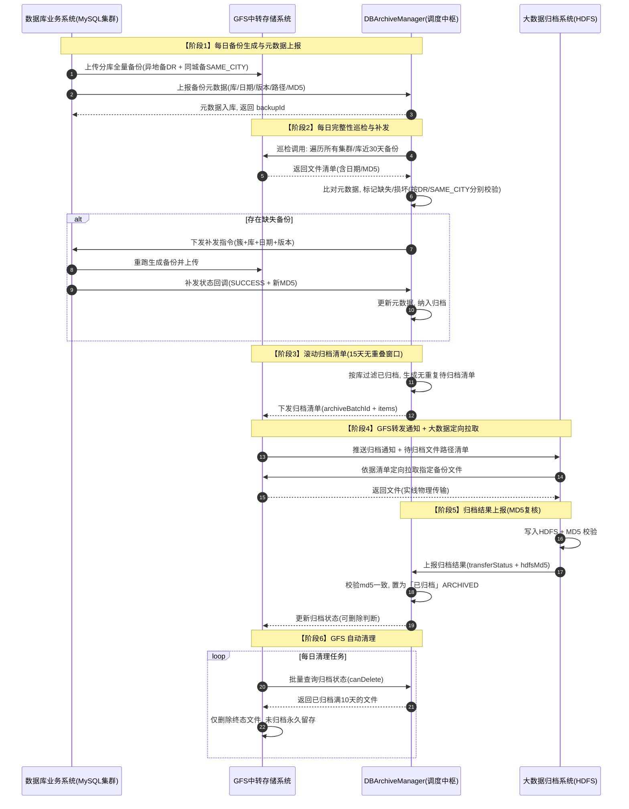

# DBArchiveManager 时序图 与 归档状态机

> 与《数据库备份策略优化方案》配套。图中贯穿 MySQL 集群「异地备/同城备」关系维度：
> 每个备份版本（DR/SAME_CITY）独立上报、独立巡检、独立归档，互不干扰。

---

## 1. 完整业务流转时序图（Mermaid）



---

## 2. 归档状态机

### 2.1 状态定义（归档生命周期）
```
┌──────────────┐
│ NOT_ARCHIVED │  ← 元数据入库/补发完成后
└──────┬───────┘
       │ 进入滚动窗口并下发清单
       ▼
┌──────────────┐
│  ARCHIVING   │  ← 已下发归档清单, 大数据拉取中
└──────┬───────┘
       │ 写入HDFS + MD5复核通过
       ▼
┌──────────────┐
│  ARCHIVED    │  ← 终态, 允许GFS清理(满10天)
└──────────────┘

异常分支:
  ARCHIVING → ARCHIVE_FAILED  (拉取失败/超时)
  ARCHIVE_FAILED → ARCHIVING  (重试, 幂等)
  ARCHIVE_FAILED → NOT_ARCHIVED (放弃归档, 下轮窗口重试)
```

### 2.2 状态机实现（Python · transitions 风格）

```python
from enum import Enum

class ArchiveStatus(str, Enum):
    NOT_ARCHIVED  = "NOT_ARCHIVED"    # 未归档
    ARCHIVING     = "ARCHIVING"       # 归档中
    ARCHIVED      = "ARCHIVED"        # 已归档(终态)
    ARCHIVE_FAILED= "ARCHIVE_FAILED"  # 归档失败


class ArchiveStateMachine:
    """库级归档元数据状态机 — 唯一业务维度: (cluster, db, backup_date, edition)"""

    # 合法迁移表: 当前状态 -> 允许可达状态集合
    ALLOWED = {
        ArchiveStatus.NOT_ARCHIVED:  {ArchiveStatus.ARCHIVING, ArchiveStatus.ARCHIVE_FAILED},
        ArchiveStatus.ARCHIVING:     {ArchiveStatus.ARCHIVED, ArchiveStatus.ARCHIVE_FAILED},
        ArchiveStatus.ARCHIVE_FAILED:{ArchiveStatus.ARCHIVING, ArchiveStatus.NOT_ARCHIVED},
        ArchiveStatus.ARCHIVED:      set(),   # 终态, 不可再迁移
    }

    def __init__(self, initial: ArchiveStatus = ArchiveStatus.NOT_ARCHIVED):
        self._state = initial

    @property
    def state(self) -> ArchiveStatus:
        return self._state

    def can(self, target: ArchiveStatus) -> bool:
        return target in self.ALLOWED[self._state]

    def transition(self, target: ArchiveStatus) -> ArchiveStatus:
        """执行状态迁移; 非法迁移抛出 ValueError, 保证幂等安全"""
        if target == self._state:
            return self._state  # 幂等: 同状态不动作
        if not self.can(target):
            raise ValueError(
                f"非法迁移: {self._state.value} -> {target.value}"
            )
        self._state = target
        return self._state


# ---- 业务事件 -> 状态迁移 映射 (controller 层调用) ----
def on_meta_round(meta):
    """元数据入库/补发完成后"""
    meta["archive_status"] = ArchiveStatus.NOT_ARCHIVED

def on_rolling_submit(meta):
    """下发归档清单"""
    fsm = ArchiveStateMachine(meta["archive_status"])
    meta["archive_status"] = fsm.transition(ArchiveStatus.ARCHIVING)

def on_archive_result(meta, hdfs_md5, file_md5):
    """大数据归档结果上报, 需 MD5 复核通过才置 ARCHIVED"""
    fsm = ArchiveStateMachine(meta["archive_status"])
    if hdfs_md5 == file_md5:
        meta["archive_status"] = fsm.transition(ArchiveStatus.ARCHIVED)
    else:
        # MD5 不一致 -> 归档失败, 可重试或回退
        new = fsm.transition(ArchiveStatus.ARCHIVE_FAILED)
        meta["archive_status"] = new

def on_retry(meta):
    """失败重试"""
    fsm = ArchiveStateMachine(meta["archive_status"])
    target = ArchiveStatus.ARCHIVING if fsm.can(ArchiveStatus.ARCHIVING) else ArchiveStatus.NOT_ARCHIVED
    meta["archive_status"] = fsm.transition(target)
```

### 2.3 关键不变量（单元测试重点）
1. **幂等**：重复上报 / 重复下发清单 / 重复上报结果，状态不产生脏迁移（同状态 transition 为空操作）。
2. **终态锁定**：`ARCHIVED` 为终态，任何事件不得回退，保证"每份备份仅归档一次"。
3. **MD5 强校验**：`ARCHIVING → ARCHIVED` 必须以 `hdfs_md5 == file_md5` 为前提。
4. **可重试**：`ARCHIVE_FAILED` 可 → `ARCHIVING`（重试）或 → `NOT_ARCHIVED`（下轮窗口）。
5. **无重叠窗口**：同一备份在 `ARCHIVING/ARCHIVED` 状态下不再进入新清单，杜绝重复归档。

### 2.4 补发任务状态机（简版）
```
PENDING --下发--> RUNNING --成功--> SUCCESS
                        \--失败(≤3次重试)--> RUNNING --> FAILED(放弃,转人工)
```

---

## 3. 时序图与清理模块差异说明（文档待澄清项）

原文档《附件》注明："完整时序图（和前面的在清理模块存在差异，需要讨论）"。

**两处口径差异（本方案已采用最终建议值，需评审确认）：**

| 项 | 原时序/流程 | 本文档采用 | 建议 |
|---|---|---|---|
| 归档窗口 | 正文/价值=15天；流程/数据库章节=14天 | 15 天（参数化 `archiveWindowDays`） | 统一为 15 天，配置化 |
| 清理触发源 | 时序图由 GFS 独立触发 | GFS 清理前**必须**查 MGR 归档状态 | 强制"先查状态后删除" |

> ⚠️ 评审时请一并确认：DbArchiveManager 是否需在"清理模块"增加**清理审批/放行**角色，
> 或继续由 GFS 自治清理（仅依赖归档状态接口判断）。此为附件标注的分歧点。
